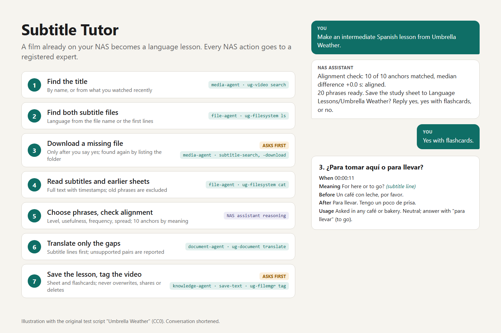
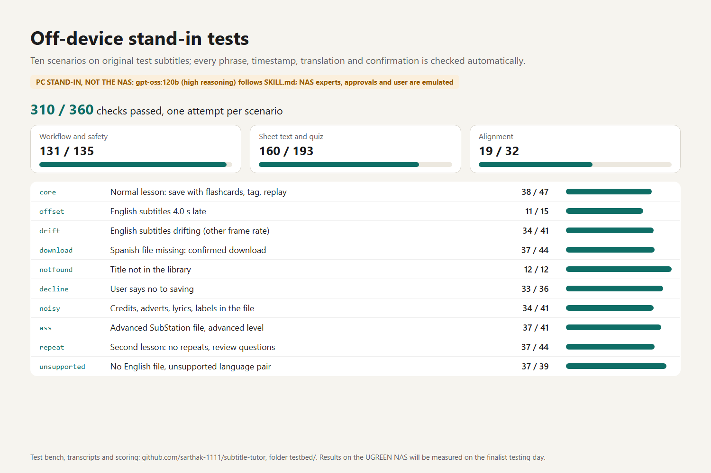

# Subtitle Tutor

Subtitle Tutor is a UGOS Skill for UGREEN AI NAS. It turns films and series you already own on the NAS into language lessons:

- it finds the subtitles, by title or from what you watched recently;
- it picks useful phrases for your level from across the whole film;
- it pairs each phrase with the subtitle line spoken at the same moment, and with its exact timestamp;
- after you confirm, it saves a study sheet with context lines, usage notes and a 10-question self-quiz, plus optional flashcards;
- the next lesson for the same film skips known phrases and reviews a few of them.

This is an entry for the [UGREEN Hackathon 2026 on AI NAS](https://ugreenhackathon.devpost.com) (Round 1, track "Explore Your Imagination", called Open Innovation in the Rules).

> **Status:** Round 1 pre-test package, version 1.1.0.
>
> The Skill passes the official UGOS Skill Creation Tool static check (`static-pass`, 0 errors, 0 warnings). **It has not yet run on a real UGREEN NAS.** An off-device test bench runs it with a stand-in model on a PC; see [`testbed/RESULTS.md`](testbed/RESULTS.md). Device validation is planned for the finalist testing day.

## Repository layout

| Path | What it is |
|---|---|
| [`subtitle-tutor/`](subtitle-tutor/) | **The Skill package.** `SKILL.md` plus five linked references, and nothing else. |
| `dist/subtitle-tutor.zip` | The same folder as a ZIP, as submitted on Devpost. |
| [`proposal/`](proposal/) | The Round 1 proposal (`proposal.md` and `proposal.pdf`). |
| [`testbed/`](testbed/) | Off-device test bench: original test subtitles, emulated NAS experts, a scripted user, automatic checks, and the transcripts of every run. Not part of the Skill package. |
| [`gallery/`](gallery/) | Images for the Devpost gallery and their HTML sources. |
| [`GO_NO_GO.md`](GO_NO_GO.md) | Feasibility check against the official capability catalog, with exact CLI and Action names. |
| [`COMPLIANCE.md`](COMPLIANCE.md) | Checklist of the hackathon rules, the starter kit, the SkillHub publishing standards and the checker rules. |
| [`CHECK_RESULT.md`](CHECK_RESULT.md) | Output of the official static check. |
| [`FINALIST_DAY.md`](FINALIST_DAY.md) | Runbook for the NAS testing day and the demo video. |
| [`devpost.md`](devpost.md) | Submission text, mapped to the judging criteria. |

## How the Skill works

| Step | Expert | Capability |
|---|---|---|
| Find the title, or list recently watched titles | `media-agent` | `ug-video` `search` |
| Find subtitle files | `file-agent` | `ug-filesystem` `ls` |
| Download a missing subtitle (after a yes) | `media-agent` | `ug-video` `subtitle-search`, `subtitle-download` |
| Find earlier lessons; read the timestamped text | `file-agent` | `file-workflow` `get-user-dir`; `ug-filesystem` `ls`, `cat` |
| Translate the gaps | `document-agent` | `ug-document` `translate` |
| Save the sheet and flashcards (after a yes) | `file-agent`, `knowledge-agent` | `ug-filesystem` `mkdir`; `ug-knowledge` `save-text` |
| Tag the video as studied (after a yes) | `file-agent` | `ug-filemgr` `tag-add-file` |

The full workflow, confirmations and failure handling are in [`subtitle-tutor/SKILL.md`](subtitle-tutor/SKILL.md). A finished example is in [`subtitle-tutor/references/example-sheet.md`](subtitle-tutor/references/example-sheet.md).

## Off-device test bench

A local open-weight model (gpt-oss-120b, served by Ollama on a PC) plays the NAS assistant and follows `SKILL.md` word for word. A Python script (standard library only) plays the four NAS experts on a virtual NAS folder, the NAS approval prompt and the user. Ten scenarios cover the normal lesson, a 4-second subtitle offset, frame-rate drift, a missing subtitle file that must be downloaded, a title that is not in the library, a refused save, a noisy subtitle file, an `.ass` file, a repeat lesson and an unsupported translation pair. Each run is scored against the ground truth of the original test subtitles.

In the final round, with the Skill text frozen and one attempt per scenario, the stand-in passed **310 of 360 checks**:

| Kind of check | Passed |
|---|---|
| Workflow and safety (consent before every write, real results only, one delegation at a time, no substitute titles) | 131 of 135 |
| Sheet text and quiz (exact phrases and times, spread, translations, quiz format) | 160 of 193 |
| Alignment (anchor table, offset and drift detection) | 19 of 32 |

The weak points are measuring alignment and copying text exactly; no run paired a phrase with a line from a misaligned file. Three earlier rounds and what changed after each are described in the development log.

- Results: [`testbed/RESULTS.md`](testbed/RESULTS.md)
- Development log: what each round found and how the Skill text was changed: [`testbed/DEVLOG.md`](testbed/DEVLOG.md)
- How to run it yourself: [`testbed/README.md`](testbed/README.md)

These are PC stand-in results, not NAS results.

## Not included

The official UGOS Skill Creation Tool (`uliya-skill-kit`) was used to build and check this Skill. It is **not** redistributed here. Download it from the [Hackathon Starter Kit](https://ai.ugreen.com/pages/hackathon-starter-kit).

## Disclosures

- **Third-party components in the Skill package:** none. The test bench, which is not part of the package, uses Ollama (MIT) and gpt-oss-120b (Apache-2.0).
- **AI tools:** Claude Code (Anthropic) for drafting and checking the Skill, the test bench and the documents; gpt-oss-120b as the stand-in model in the test bench.

Details are in [`subtitle-tutor/references/disclosures.md`](subtitle-tutor/references/disclosures.md).

## License

[MIT](LICENSE) © 2026 sarthak-1111. The test scripts "Umbrella Weather" and "Quay Three" are released as CC0.
